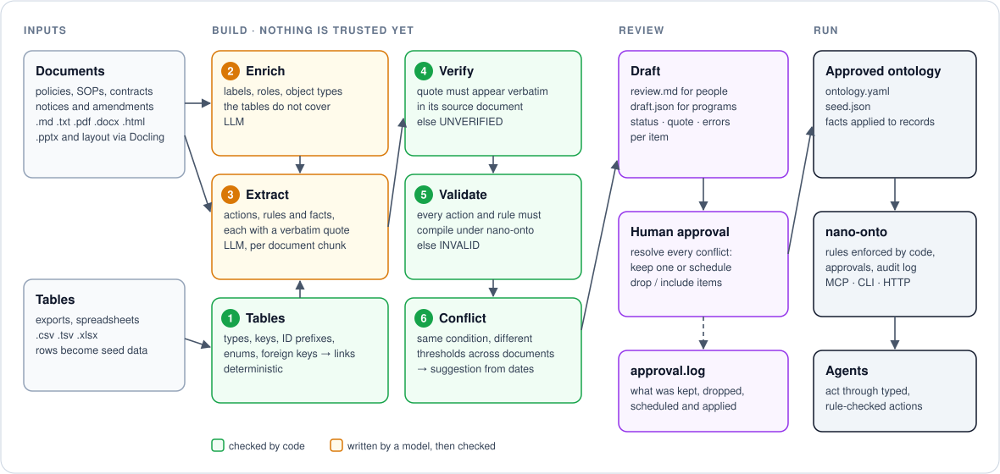

<div align="center">

# 🧬 Ontology-Anything: Documents In, Executable Ontology Out

<p>
  <a href="https://github.com/JayLZhou/Ontology-Anything"></a>
  <a href="https://github.com/JayLZhou/nano-ontology"></a>
  <a href="https://github.com/JayLZhou/Ontology-Anything/actions/workflows/test.yaml"></a>
</p>
<p>
  <a href="https://github.com/JayLZhou/Ontology-Anything/stargazers"></a>
  
  <a href="LICENSE"></a>
</p>
<p>
  <a href="README_zh.md"></a>
  <a href="README.md"></a>
</p>

**Policies, SOPs, contracts and spreadsheets → object types, links, roles and rule-checked actions.**<br>Every rule backed by a verbatim quote, every conflict surfaced, nothing live until a person approves it.

<a href="#-quick-start"></a>

</div>

---

## 🎉 News

- [X] [2026.11] 🎯 v0.2.0: **tables inside documents** (Markdown, DOCX, HTML) are read in place and record lists become data; **long corpora** get concurrent extraction, an on-disk answer cache with resume, automatic retries and an optional filter for chunks without rules.
- [X] [2026.11] 🎯 Ontology-Anything v0.1.0 is released: tables + documents → reviewed, executable ontology, with a demo that runs without an API key.

---

## 🌟 System Overview

*From what documents say to what agents may do*

Knowledge-graph builders extract **facts** ("S-003 is a supplier"). That is enough to *answer questions*. Businesses, however, run on **rules** ("purchases over ¥50,000 need CFO approval"), and those rules are scattered across documents that disagree with each other and change over time. An agent that is allowed to *change things* -- submit an order, cancel a contract, blacklist a supplier -- needs those rules as something a program can enforce, not as prompt text.

**Ontology-Anything** reads a folder of policies and spreadsheets and produces an **executable ontology**: object types, links, roles, and *actions guarded by rules*, in the format of [nano-onto](https://github.com/JayLZhou/nano-ontology), which enforces them outside the model and serves them to agents over MCP.

It is built on one principle: **the model is not trusted**. Every rule must quote the sentence it came from, and the quote is checked against the source. Every rule must compile against the real schema. Rules from different documents that disagree are paired up rather than silently merged. And the result is a *draft* -- nothing reaches an agent until a person has approved it.



### 🎯 Key Features

- **🔄 End-to-End Pipeline** - From a folder of mixed files to an ontology that agents can act on, in two commands: `build` and `approve`
- **📑 Rules, Not Just Facts** - Extracts typed actions with parameters, allowed roles and effects, guarded by `deny` / `warn` / `require_approval` rules
- **🔍 Verbatim Provenance** - Every rule and fact carries the sentence it relies on; quotes that are not found in the source are marked UNVERIFIED and left out by default
- **🧪 Compile-Checked** - Every action and rule is compiled by nano-onto against the inferred schema; rules on fields that do not exist are INVALID
- **⚔️ Conflict Detection** - Finds rules with the same condition and different thresholds across documents and suggests a resolution from document dates
- **🗓️ Scheduled Rule Changes** - "Effective from 1 December" becomes two rules that switch over on that date by themselves
- **📊 Deterministic Table Schema** - Types, primary keys, ID prefixes, enums and foreign keys → links are inferred from spreadsheets without any model
- **🧩 Tables Inside Documents** - Tables in Markdown, DOCX and HTML stay in the text as tables, so rules written as a matrix can be read and quoted; tables that list records become data like a spreadsheet
- **⚡ Built for Long Corpora** - Concurrent extraction, an on-disk answer cache that resumes interrupted builds and only re-asks about what changed, automatic retries on rate limits
- **🧾 Facts Applied to Data** - "Supplier S-003 is blacklisted" is checked against the records and applied to the seed data on approval
- **🙋 Human in the Loop** - A readable review report, explicit decisions, and an approval log of everything that was kept, dropped and scheduled
- **📼 Record / Replay** - Record a model's answers once, then rebuild deterministically with no network: for tests, CI and iterating on review decisions
- **🔌 Any OpenAI-Compatible Model** - OpenAI, DeepSeek, Qwen, Ollama, vLLM, LM Studio, or your own client with a single method

---

## 🏗️ Algorithm & Architecture

### Core Algorithm

**Ontology-Anything** is a six-stage pipeline in which the model only ever *proposes*. Two stages use an LLM; four are plain code, and three of those exist to check what the LLM wrote.

<div align="center">

📊 **Tables** → 🏷️ **Enrich** → 📝 **Extract** → 🔍 **Verify** → 🧪 **Validate** → ⚔️ **Conflict** → 🙋 **Approve**

</div>

### 1. Table Schema Induction

Spreadsheets already contain most of a schema, so no model is asked for it.

- **🧱 Object Types**: one per table (`purchase_orders.csv` → `PurchaseOrder`), with each column typed as string, number, integer, boolean or date. Values with leading zeros stay strings.
- **🔑 Keys and Prefixes**: the primary key is a unique, fully populated column, preferring names that look like identifiers; a shared ID prefix such as `PO-` is recorded.
- **🧮 Enums**: low-cardinality string columns become enumerations.
- **🔗 Foreign Keys → Links**: a column whose values are all primary keys of another table becomes a link type, and the rows become link instances. A plain value column that merely happens to match is not treated as a key.
- **🧩 Tables Inside Documents**: a table in a document that has an identifier column (an appendix listing approved suppliers) is treated like a spreadsheet and can be the target of links from one. A table without one (an approval matrix, a fee schedule) is a *rule*, not data: it stays in the text for the extraction stage.

### 2. Enrichment (LLM)

One call over excerpts of the documents adds what tables cannot express: human-readable **labels** in the documents' language, **roles** (employee, department manager, CFO), and **object types the documents describe but the tables do not cover**.

### 3. Extraction (LLM)

Each document chunk is read with the inferred schema in the prompt, so the model writes against real property names. Chunks are sent one at a time or in parallel batches; every chunk is told which actions earlier ones found, so that rules in a later notice attach to the action a policy defined. It returns:

- **⚙️ Actions**: name, parameters (including references to objects), allowed roles and effects (`create`, `update`, `link`).
- **📏 Rules**: a condition in nano-onto's expression language, an outcome (`deny`, `warn`, or `require_approval` by a role), a message, and an effective date when the text gives one.
- **🧾 Facts**: statements that change specific records.
- **💬 A quote for every item**: the exact sentence it relied on.

### 4. Quote Verification

Each quote must appear **verbatim** in its source document, ignoring only whitespace and full-/half-width differences. Anything else is `UNVERIFIED`. This is what catches a rule the model invented, or one it "remembered" from somewhere other than your documents.

### 5. Compile Validation

Each action, and then each rule on its own, is compiled by nano-onto against the schema. A rule that mentions `params.supplier.suspended` when suppliers have no such property is `INVALID`, with the compiler's message attached. The *shape* of the answer is untrusted as well: wrong types, missing keys and non-JSON replies turn into notes or INVALID items, never a crash.

### 6. Conflict Detection

Rules on the same action that compare the same expression with the same outcome are grouped. Different thresholds are a `threshold_mismatch`; the same threshold twice is a `duplicate`. Each rule is dated from its own text or its document, and the suggestion follows: **schedule** if the newer rule is not in force yet, **keep the newest** if it is, and no suggestion when there are no dates.

### 7. Human Review & Approval

`build` writes `review.md`, with every item, its status and its source sentence side by side. `approve` then applies explicit decisions, refuses to proceed while a conflict is undecided, leaves out INVALID items, checks that the final ontology compiles as a whole, applies accepted facts to the data, and logs everything it did.

---

## 🚀 Quick Start

*Two minutes, no API key*

### Installation

```bash
git clone https://github.com/JayLZhou/Ontology-Anything.git
cd Ontology-Anything
pip install -e .            # also installs nano-onto from its GitHub repository
```

#### Optional Dependencies

```bash
pip install -e ".[office]"   # .xlsx, .pdf and .docx inputs
pip install -e ".[docling]"  # layout-aware PDF / DOCX / PPTX parsing with Docling
pip install -e ".[dev]"      # pytest
```

### Run the Demo

```bash
ontology-anything demo
```

The demo reads a procurement policy, a later notice that changes one approval threshold and blacklists a supplier, and two CSV files (all in [`examples/procurement`](examples/procurement)). The model's answers are **recorded** in `cassette.json` -- including one deliberately hallucinated rule and one that references a non-existent field -- so the run is deterministic:

```
== 1. build from examples/procurement/docs and examples/procurement/data (recorded LLM answers)
loaded 2 documents, 2 tables
  tables: 2 object types, 1 links, 18 records
  enrich: 3 roles, 2 object types
  draft: 3 actions, 8 rules, 1 facts, 1 conflicts

== 2. approve without resolving conflicts (expected to stop)
not approved: unresolved conflicts:
  C1: cfo_over_50k: params.amount > 50000 -> approval:cfo (from docs/采购管理制度.md, effective 2025-01-01);
      cfo_over_30k: params.amount > 30000 -> approval:cfo (from docs/关于调整采购审批权限的通知.md, effective 2026-12-01)
      suggested: schedule

== 3. approve with the suggested resolutions
  C1: scheduled cfo_over_50k@2025-01-01 -> cfo_over_30k@2026-12-01
  left out rule:no_purchase_from_suspended: invalid (... Supplier has no property or link 'suspended')
  left out rule:warn_rating_c: quote not verified (use --include-unverified to keep)
  applied fact:1: Supplier S-003 {'blacklisted': True}
approved: 2 object types, 3 actions, 6 rules

== 4. run the result with nano-onto
  2026-11-24: 40000 元采购 -> pending_approval ['dept_manager']
  2026-12-02: 40000 元采购 -> pending_approval ['cfo', 'dept_manager']
  向 S-003（通知里拉黑的供应商）采购 -> denied: 不得向黑名单供应商采购
```

(Output trimmed. Add `--out demo-out` to keep `review.md`, `ontology.yaml` and `seed.json`.)

### Usage Examples

#### 1. End-to-End on Your Own Files

```bash
cp .env.example .env        # then set OA_API_KEY (any OpenAI-compatible endpoint)

# 1. build a draft; inputs are files and/or folders
ontology-anything build ./policies ./exports -o out --name procurement --llm record:out/cassette.json

# 2. read out/review.md, then approve
ontology-anything approve out --resolve C1=keep:cfo_over_30k --drop rule:some_rule

# 3. hand the result to nano-onto, and to your agents over MCP
nano-onto init --schema out/ontology.yaml --db out/nano_onto.db --seed out/seed.json
nano-onto serve-mcp --schema out/ontology.yaml --db out/nano_onto.db --actor alice --role employee
```

#### 2. Python API

```python
from ontology_anything import load_corpus, build, approve, render_review
from ontology_anything.llm import OpenAICompatLLM

corpus = load_corpus(["./policies", "./exports"])
draft = build(corpus, OpenAICompatLLM(), name="procurement")

print(render_review(draft))                       # the same report as review.md
for item_id, item in draft.items.items():
    if item["status"] != "proposed":
        print(item_id, item["status"], item["errors"])

ontology, seed, log = approve(draft, accept_suggestions=True)
```

#### 3. Resolving Conflicts

```bash
ontology-anything approve out --resolve C1=keep:cfo_over_30k   # keep one rule, remove the others
ontology-anything approve out --resolve C1=schedule            # keep all, switch on the effective date
ontology-anything approve out --accept-suggestions             # take every suggestion
```

`schedule` rewrites the conditions so that exactly one rule is active at a time:

```yaml
- id: cfo_over_50k
  when: (params.amount > 50000) and today() < '2026-12-01'
- id: cfo_over_30k
  when: (params.amount > 30000) and today() >= '2026-12-01'
```

See [Review and approval](docs/review_and_approval.md) for statuses, suggestions and what approval guarantees.

#### 4. Record Once, Replay Forever

```bash
ontology-anything build ./policies ./exports -o out --llm record:out/cassette.json   # calls the model
ontology-anything build ./policies ./exports -o out --llm replay:out/cassette.json   # no network
```

#### 5. Your Own Model Client

```python
class MyLLM:
    def complete(self, key: str, system: str, user: str) -> str:
        ...  # return the model's reply; `key` names the call, e.g. "extract:policy.md#0"

draft = build(corpus, MyLLM(), name="procurement")
```

See [Models: providers, record / replay, custom clients](docs/llm_backends.md).

#### 6. Long Corpora

```bash
ontology-anything build ./policies ./exports -o out --workers 8 --skip-irrelevant
```

- **`--workers 8`** sends eight extraction calls at a time. Chunks in the same batch do not see the actions the others find, only those of earlier batches; with the default of 1 every chunk sees everything before it.
- **Answers are cached** in `out/.llm-cache`, keyed by model and prompt. Run the same command again after an interruption, or after editing one document, and only the prompts that changed are sent: the build prints `model calls: 3 new, 212 answered from out/.llm-cache`. `--no-cache` turns it off.
- **Rate limits and transient errors** (HTTP 429, 5xx, timeouts) are retried with backoff, honouring `Retry-After`.
- **`--skip-irrelevant`** does not send chunks that contain no rule-like wording at all (no "must", "may not", "approval", "须", "不得", …). It is a keyword test, so it is off by default; every skipped chunk is listed in the notes of `review.md`.
- **`--chunk-size 3000`** sends smaller pieces, which makes skipping and caching finer-grained.

#### 7. Tables Inside Documents

```markdown
## Appendix 1: Approved suppliers        ← has an id column: becomes the object type ApprovedSupplier

| supplier_id | name |
|---|---|
| S-1 | Acme |

Table 2: Approval limits                 ← no id column: stays text, read as rules

| Amount | Approver |
|---|---|
| over 50,000 | CFO |
```

The same applies to tables in DOCX and HTML files, and to PDFs parsed with `--parser docling`. `--doc-tables all` turns every table into data, `--doc-tables off` none; the default `auto` is described above, and the notes of `review.md` say what happened to each table.

#### 8. Tables Only (No Model)

```bash
ontology-anything build ./exports -o out --llm none
```

```python
from ontology_anything import infer_tables, load_corpus

schema = infer_tables(load_corpus(["./exports"]).tables)
print(schema.object_types, schema.link_types)
```

---

## 🛠️ Examples

*Runnable without an API key*

The `examples/` directory contains:

- **`procurement_example.py`**: End-to-end with the Python API -- load, build, review, approve, then execute actions with nano-onto. `--live` calls a real model instead of the recording
- **`tables_only_example.py`**: What schema induction infers from spreadsheets alone; pass your own files or folders
- **`custom_llm_example.py`**: Wrapping a model client with logging and an on-disk cache
- **`procurement/`**: The demo corpus -- two policy documents, two CSV files and the recorded model answers

```bash
python examples/procurement_example.py
python examples/tables_only_example.py ./my-exports
python examples/custom_llm_example.py
```

---

## 🔧 Configuration

### Environment Variables

Create a `.env` file in the folder you run the command in (refer to [`.env.example`](.env.example)); variables already set in the shell take precedence.

```bash
OA_API_KEY=your-api-key                      # falls back to OPENAI_API_KEY
OA_BASE_URL=https://api.deepseek.com/v1      # Optional, defaults to OpenAI
OA_MODEL=deepseek-chat                       # Optional, defaults to gpt-4o-mini
OA_LLM=openai                                # Optional default for `build --llm`
OA_WORKERS=8                                 # Optional default for `build --workers`
```

> **Note**: No API key is needed for the demo, the examples, the tests, `--llm replay:<file>` or `--llm none`.

### `build` Options

| Option | Meaning |
|---|---|
| `-o, --out` | output folder (default `onto-out`) |
| `--name` | name of the ontology |
| `--llm openai` | call the model at `OA_BASE_URL` (the default) |
| `--llm record:<file>` | call the model and save every answer to a cassette |
| `--llm replay:<file>` | answer from a cassette without calling anything |
| `--llm none` | tables only: types, keys and links, no actions or rules |
| `--model` | model name, overriding `OA_MODEL` |
| `--parser builtin\|docling` | how PDF / DOCX / PPTX are read (see below) |
| `--today YYYY-MM-DD` | the date used to decide whether a newer rule is already in force |
| `--workers N` | extraction calls sent at a time (default 1, or `OA_WORKERS`) |
| `--chunk-size N` | characters per document chunk (default 6000) |
| `--skip-irrelevant` | do not send chunks without any rule-like wording |
| `--doc-tables auto\|all\|off` | which tables inside documents also become data (default `auto`: those with an id column) |
| `--cache-dir DIR` / `--no-cache` | where model answers are cached (default `<out>/.llm-cache`) / do not cache |

### `approve` Options

| Option | Meaning |
|---|---|
| `--resolve C1=keep:<rule id>` | keep one rule of a conflict, remove the others |
| `--resolve C1=schedule` | keep all of them, each guarded by its effective date |
| `--resolve C1=suggested` | take the suggestion for one conflict |
| `--accept-suggestions` | take the suggestion for every conflict |
| `--drop <item id>` | leave an item out: `rule:…`, `action:…`, `fact:…`, `role:…`, `object_type:…` |
| `--include-unverified` | keep items whose quotes could not be matched (e.g. OCR noise) -- read them first |

### Parser Configuration

- **Built-in (default)**: light parsers with no model downloads -- pypdf for PDF text, python-docx for DOCX paragraphs, headings and tables in reading order, and an HTML reader that keeps headings and tables. Good for born-digital text. Tables in PDFs are not recovered by the built-in parser.
- **Docling**: `--parser docling` routes PDF, DOCX and PPTX through [Docling](https://github.com/docling-project/docling) for layout-aware parsing and scanned pages. Quote verification is strict, so clean text matters: prefer Docling for complex layouts.

### Output Files

| File | Written by | What it is |
|---|---|---|
| `review.md` | `build` | the report a person reads: every item with status, source quote and errors |
| `draft.json` | `build` | the full draft, the input to `approve` |
| `ontology.draft.yaml` | `build` | the unapproved ontology, for diffing |
| `ontology.yaml`, `seed.json` | `approve` | what nano-onto loads |
| `approval.log` | `approve` | what was kept, dropped, scheduled and applied |

---

## 🧪 Supported Content Types

### Documents

- **Markdown and text** - `.md`, `.markdown`, `.txt`
- **PDF** - `.pdf` (needs `[office]`, or `--parser docling`)
- **Word** - `.docx` (needs `[office]`, or `--parser docling`)
- **PowerPoint** - `.pptx` (`--parser docling` only)
- **HTML** - `.html`, `.htm`

### Tables

- **Delimited text** - `.csv` (comma, semicolon or tab, detected), `.tsv`
- **Excel** - `.xlsx`, `.xlsm`; one object type per sheet (needs `[office]`)
- **Tables inside documents** - Markdown pipe tables, DOCX tables, HTML `<table>`, and whatever Docling exports as tables

### What Is Extracted

- **Object types and links** - from tables, plus types the documents clearly describe
- **Roles** - who may act and who must approve
- **Actions** - typed operations with parameters and effects
- **Rules** - conditions with a `deny`, `warn` or `require_approval` outcome
- **Facts** - changes to specific records stated in text

Unsupported files are skipped and listed in the notes of the review report.

---

## ⚠️ Limitations

- By default every chunk of every document is sent to the model once. The cache makes rebuilds cheap and `--skip-irrelevant` drops chunks without rule wording, but there is no retrieval of the relevant chunks per action yet (see roadmap).
- With `--workers` above 1, chunks in the same batch cannot reuse each other's action names, which can produce duplicate actions on corpora where many documents describe the same operation.
- Tables in PDFs need `--parser docling`; merged cells in DOCX and HTML tables are flattened.
- Conflict detection covers single-comparison thresholds (`params.amount > 50000`) with the same outcome. Overlapping compound conditions are not detected.
- Dates are recognised as `YYYY-MM-DD` and `2026年12月1日`; "effective from" detection knows Chinese (`自…起`) and English (`effective from …`).
- A verified, compiling rule is still the model's reading of a sentence. Verification proves the sentence exists, not that the rule means the same thing -- which is why approval is a human step.

## 🗺️ Roadmap

- [x] Tables inside documents (Markdown, DOCX, HTML) as rule text and as data
- [x] Long corpora: concurrent extraction, answer cache with resume, retries, optional chunk filter
- [ ] Long documents: retrieval of relevant chunks per action instead of every chunk
- [ ] Rule conflicts beyond thresholds (overlapping conditions, deny vs. approve), via an SMT check
- [ ] Incremental rebuilds: diff a new document against an approved ontology, propose a patch
- [ ] Ontology evolution from agent traces (repeated denials / manual overrides → rule review)
- [ ] Web review UI (accept / edit / reject per item, side-by-side with the source)
- [ ] Benchmark: rule extraction accuracy on public policy corpora

---

## 📖 Citation

If you find Ontology-Anything useful in your work, please cite the repository:

```bibtex
@misc{ontologyanything2026,
  title        = {Ontology-Anything: Documents In, Executable Ontology Out},
  author       = {{The Ontology-Anything Authors}},
  year         = {2026},
  howpublished = {\url{https://github.com/JayLZhou/Ontology-Anything}},
}
```

---

## 🔗 Related Projects

*Ecosystem & Acknowledgements*

<div align="center">
  <table>
    <tr>
      <td align="center">
        <a href="https://github.com/JayLZhou/nano-ontology">
          <b>⚡ nano-onto</b><br>
          <sub>The executable ontology runtime<br>these outputs run on</sub>
        </a>
      </td>
      <td align="center">
        <a href="https://github.com/HKUDS/RAG-Anything">
          <b>🚀 RAG-Anything</b><br>
          <sub>All-in-One Multimodal RAG;<br>the inspiration for the name</sub>
        </a>
      </td>
      <td align="center">
        <a href="https://github.com/HKUDS/LightRAG">
          <b>💡 LightRAG</b><br>
          <sub>Simple and Fast<br>graph-based RAG</sub>
        </a>
      </td>
      <td align="center">
        <a href="https://github.com/docling-project/docling">
          <b>📄 Docling</b><br>
          <sub>Layout-aware document parsing,<br>available as a parser here</sub>
        </a>
      </td>
    </tr>
  </table>
</div>

---

## 🤝 Contribution

Issues and pull requests are welcome. To get started:

```bash
pip install -e ".[dev]"
pytest                      # no network or API key needed
ontology-anything demo
```

Tests replay model answers from a cassette or a local stub; please keep new tests offline too, and update both READMEs when behavior changes.

<div align="center">
  <a href="https://github.com/JayLZhou/Ontology-Anything/graphs/contributors">
    
  </a>
</div>

---

<div align="center">
  <a href="https://github.com/JayLZhou/Ontology-Anything"></a>
  <a href="https://github.com/JayLZhou/Ontology-Anything/issues"></a>
</div>

<div align="center">

Thank you for visiting Ontology-Anything · MIT License

</div>
