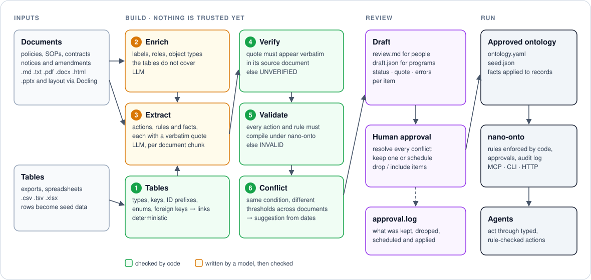

<div align="center">

# 🧬 Ontology-Anything: 文档进，可执行本体出

<p>
  <a href="https://github.com/JayLZhou/Ontology-Anything"></a>
  <a href="https://github.com/JayLZhou/nano-ontology"></a>
  <a href="https://github.com/JayLZhou/Ontology-Anything/actions/workflows/test.yaml"></a>
</p>
<p>
  <a href="https://github.com/JayLZhou/Ontology-Anything/stargazers"></a>
  
  <a href="LICENSE"></a>
</p>
<p>
  <a href="README_zh.md"></a>
  <a href="README.md"></a>
</p>

**制度、SOP、合同、表格 → 对象类型、关系、角色和带规则校验的动作。**<br>每条规则都有逐字原文引用，文件之间的冲突全部标出，人工批准前不生效。

<a href="#-快速开始"></a>

</div>

---

## 🎉 最新动态

- [X] [2026.11] 🎯 v0.2.0：支持**文档内的表格**（Markdown、DOCX、HTML），表格原位保留，记录清单类的表格直接作为数据；**长语料**支持并发抽取、可续跑的磁盘缓存、自动重试，以及可选的"无规则分块"过滤。
- [X] [2026.11] 🎯 Ontology-Anything v0.1.0 发布：表格 + 文档 → 经人工审核的可执行本体，自带无需 API Key 的 demo。

---

## 🌟 系统概览

*从"文件怎么写"到"agent 能做什么"*

知识图谱工具抽的是**事实**（"S-003 是一家供应商"），这足以*回答问题*。但企业靠的是**规则**（"超过 5 万元的采购须财务总监审批"），而规则散落在多份文件里，彼此矛盾，还会随时间变化。一个被允许*改动业务*的 agent——提交采购单、取消合同、拉黑供应商——需要的是程序能强制执行的规则，而不是写在提示词里的一段话。

**Ontology-Anything** 读入一个装着制度文件和表格的文件夹，输出一份**可执行本体**：对象类型、关系、角色，以及*带规则校验的动作*。产物采用 [nano-onto](https://github.com/JayLZhou/nano-ontology) 的格式，由它在模型之外强制执行规则，并通过 MCP 提供给 agent。

整个系统只遵循一条原则：**不信任模型**。每条规则必须引用它依据的原句，引用会与原文逐字核对；每条规则必须能在真实 schema 上通过编译；不同文件里互相矛盾的规则会被配对标出，而不是悄悄合并；最终产物只是一份*草稿*——人工批准之前，任何内容都到不了 agent 手里。



### 🎯 核心特性

- **🔄 端到端流程** - 从一个混合文件夹到 agent 可以直接使用的本体，只需两条命令：`build` 和 `approve`
- **📑 抽规则，而不只是事实** - 抽取带参数、允许角色和效果的类型化动作，并由 `deny` / `warn` / `require_approval` 规则把关
- **🔍 逐字溯源** - 每条规则和事实都附带所依据的原句；原文中找不到的引用标为 UNVERIFIED，默认不采纳
- **🧪 编译检查** - 每个动作和规则都由 nano-onto 在推断出的 schema 上编译；引用不存在字段的规则判为 INVALID
- **⚔️ 冲突检测** - 找出不同文件中条件相同、阈值不同的规则，并根据文件日期给出处理建议
- **🗓️ 规则按日期切换** - "自 12 月 1 日起施行"会变成两条规则，到期自动切换
- **📊 确定性表格建模** - 类型、主键、编号前缀、枚举、外键 → 关系，全部从表格直接推断，不用任何模型
- **🧩 文档内的表格** - Markdown、DOCX、HTML 里的表格以表格形式保留在正文中，写成矩阵的规则也能被读到和引用；记录清单类的表格则像电子表格一样成为数据
- **⚡ 为长语料而设计** - 并发抽取；磁盘缓存让中断的构建可以续跑，并且只重新询问有变化的部分；遇到限流自动重试
- **🧾 事实落到数据上** - "供应商 S-003 列入黑名单"会与数据核对，并在批准时写入初始数据
- **🙋 人在回路** - 可读的审核报告、显式的决定，以及记录了保留 / 剔除 / 排期的批准日志
- **📼 录制 / 回放** - 模型回答录一次，之后离线、确定性地重建：用于测试、CI 和反复调整审核决定
- **🔌 任意 OpenAI 兼容模型** - OpenAI、DeepSeek、通义千问、Ollama、vLLM、LM Studio，或只需实现一个方法的自定义客户端

---

## 🏗️ 算法与架构

### 核心算法

**Ontology-Anything** 是一条六阶段流水线，模型在其中只负责*提议*。两个阶段使用大模型，四个阶段是普通代码，其中三个专门用来检查大模型写的内容。

<div align="center">

📊 **表格** → 🏷️ **补全** → 📝 **抽取** → 🔍 **核对** → 🧪 **校验** → ⚔️ **冲突** → 🙋 **批准**

</div>

### 1. 表格建模（Tables）

表格里本来就有大部分 schema，所以这一步不问模型。

- **🧱 对象类型**：一张表一个类型（`purchase_orders.csv` → `PurchaseOrder`），每列推断为 string、number、integer、boolean 或 date。带前导零的值保持为字符串。
- **🔑 主键与前缀**：主键取唯一且无空值的列，优先选名字像编号的列；共同的编号前缀（如 `PO-`）会被记录下来。
- **🧮 枚举**：取值很少的字符串列成为枚举。
- **🔗 外键 → 关系**：如果某列的值全部是另一张表的主键，这一列就成为关系类型，各行成为关系实例。只是数值碰巧相同的普通列不会被当作外键。
- **🧩 文档内的表格**：文档里带编号列的表格（比如附件中的合格供应商名录）会被当作电子表格处理，也可以成为其他表外键指向的目标。没有编号列的表格（审批权限表、收费标准）是*规则*而不是数据，保留在正文里交给抽取阶段。

### 2. 补全（Enrich，LLM）

对文档摘录做一次调用，补上表格表达不了的内容：与文档同语言的**标签**、**角色**（员工、部门经理、财务总监），以及**文档里描述了但表格没有覆盖的对象类型**。

### 3. 抽取（Extract，LLM）

逐块阅读文档，并把推断出的 schema 放进提示词，让模型针对真实的字段名写规则。分块可以逐个发送，也可以分批并发；每个分块都会被告知之前已经发现的动作，这样后发通知里的规则才能挂到制度里定义的动作上。返回内容包括：

- **⚙️ 动作**：名称、参数（可以引用对象）、允许的角色，以及效果（`create`、`update`、`link`）。
- **📏 规则**：用 nano-onto 表达式写的条件、结果（`deny`、`warn` 或由某角色 `require_approval`）、提示信息，以及文中给出的生效日期。
- **🧾 事实**：会改变具体记录的陈述。
- **💬 每一项都要有引用**：它所依据的原句。

### 4. 引用核对（Verify）

每条引用必须在来源文档中**逐字**出现，只忽略空白和全角 / 半角差异，否则标为 `UNVERIFIED`。模型编造的规则，或者它从别处"记来"而不是出自你文档的规则，就是在这一步被拦下的。

### 5. 编译校验（Validate）

每个动作、随后每条规则，都单独交给 nano-onto 在 schema 上编译。供应商没有 `suspended` 这个字段，而规则写了 `params.supplier.suspended`，就判为 `INVALID`，并附上编译器的报错。模型输出的*结构*同样不可信：类型错误、缺字段、非 JSON 的回答只会变成备注或 INVALID 条目，不会让程序崩溃。

### 6. 冲突检测（Conflict）

同一动作上，比较同一表达式且结果相同的规则会被分到一组。阈值不同是 `threshold_mismatch`，同一阈值出现两次是 `duplicate`。每条规则的日期取自规则原文或所在文档，建议随之而定：新规则尚未生效则**排期（schedule）**，已生效则**保留最新**，没有日期则不给建议。

### 7. 人工审核与批准

`build` 生成 `review.md`，把每个条目、它的状态和原句并排列出。`approve` 再按显式的决定执行：只要有冲突未决就拒绝继续，剔除 INVALID 条目，检查最终本体整体能否编译，把被接受的事实写入数据，并记录所做的每一步。

---

## 🚀 快速开始

*两分钟，不需要 API Key*

### 安装

```bash
git clone https://github.com/JayLZhou/Ontology-Anything.git
cd Ontology-Anything
pip install -e .            # 会同时从 GitHub 安装 nano-onto
```

#### 可选依赖

```bash
pip install -e ".[office]"   # 支持 .xlsx / .pdf / .docx 输入
pip install -e ".[docling]"  # 用 Docling 做 PDF / DOCX / PPTX 版面解析
pip install -e ".[dev]"      # pytest
```

### 运行 Demo

```bash
ontology-anything demo
```

示例输入在 [`examples/procurement`](examples/procurement)：一份采购制度、一份后发的通知（把财务总监审批门槛从 5 万改成 3 万，12 月 1 日生效，并拉黑供应商 S-003）、两张 CSV。模型的回答**预先录制**在 `cassette.json` 里（故意放了一条编造引用的规则和一条引用不存在字段的规则），所以每次结果一致：

```
== 1. build from examples/procurement/docs and examples/procurement/data (recorded LLM answers)
loaded 2 documents, 2 tables
  tables: 2 object types, 1 links, 18 records
  enrich: 3 roles, 2 object types
  draft: 3 actions, 8 rules, 1 facts, 1 conflicts

== 2. approve without resolving conflicts (expected to stop)
not approved: unresolved conflicts:
  C1: cfo_over_50k: params.amount > 50000 -> approval:cfo (from docs/采购管理制度.md, effective 2025-01-01);
      cfo_over_30k: params.amount > 30000 -> approval:cfo (from docs/关于调整采购审批权限的通知.md, effective 2026-12-01)
      suggested: schedule

== 3. approve with the suggested resolutions
  C1: scheduled cfo_over_50k@2025-01-01 -> cfo_over_30k@2026-12-01
  left out rule:no_purchase_from_suspended: invalid (... Supplier has no property or link 'suspended')
  left out rule:warn_rating_c: quote not verified (use --include-unverified to keep)
  applied fact:1: Supplier S-003 {'blacklisted': True}
approved: 2 object types, 3 actions, 6 rules

== 4. run the result with nano-onto
  2026-11-24: 40000 元采购 -> pending_approval ['dept_manager']
  2026-12-02: 40000 元采购 -> pending_approval ['cfo', 'dept_manager']
  向 S-003（通知里拉黑的供应商）采购 -> denied: 不得向黑名单供应商采购
```

（输出有删节。加 `--out demo-out` 可以保留 `review.md`、`ontology.yaml` 和 `seed.json`。）

也就是说：

1. 发现 5 万 vs 3 万的冲突，建议 `schedule`；
2. 不解决冲突就拒绝批准；
3. 批准后自动剔除编造的和编译不过的规则，并把"S-003 拉黑"应用到数据上；
4. 交给 nano-onto 运行：11 月 24 日 4 万元采购只需部门经理批；12 月 2 日起还需财务总监；向 S-003 下单直接被拒。

### 使用示例

#### 1. 在自己的文件上端到端运行

```bash
cp .env.example .env        # 然后填入 OA_API_KEY（任意 OpenAI 兼容接口）

# 1. 生成草稿；输入可以是文件，也可以是文件夹
ontology-anything build ./制度 ./导出数据 -o out --name procurement --llm record:out/cassette.json

# 2. 先读 out/review.md，再批准
ontology-anything approve out --resolve C1=keep:cfo_over_30k --drop rule:某条规则

# 3. 交给 nano-onto，并通过 MCP 提供给 agent
nano-onto init --schema out/ontology.yaml --db out/nano_onto.db --seed out/seed.json
nano-onto serve-mcp --schema out/ontology.yaml --db out/nano_onto.db --actor alice --role employee
```

#### 2. Python API

```python
from ontology_anything import load_corpus, build, approve, render_review
from ontology_anything.llm import OpenAICompatLLM

corpus = load_corpus(["./制度", "./导出数据"])
draft = build(corpus, OpenAICompatLLM(), name="procurement")

print(render_review(draft))                       # 与 review.md 内容相同
for item_id, item in draft.items.items():
    if item["status"] != "proposed":
        print(item_id, item["status"], item["errors"])

ontology, seed, log = approve(draft, accept_suggestions=True)
```

#### 3. 解决冲突

```bash
ontology-anything approve out --resolve C1=keep:cfo_over_30k   # 只保留一条，其余删除
ontology-anything approve out --resolve C1=schedule            # 全部保留，按生效日期切换
ontology-anything approve out --accept-suggestions             # 全部采用建议
```

`schedule` 会改写规则条件，保证任一时刻只有一条生效：

```yaml
- id: cfo_over_50k
  when: (params.amount > 50000) and today() < '2026-12-01'
- id: cfo_over_30k
  when: (params.amount > 30000) and today() >= '2026-12-01'
```

条目状态、建议的来源以及批准所保证的内容，见[审核与批准](docs/review_and_approval.md)（英文）。

#### 4. 录制一次，反复回放

```bash
ontology-anything build ./制度 ./导出数据 -o out --llm record:out/cassette.json   # 调用模型
ontology-anything build ./制度 ./导出数据 -o out --llm replay:out/cassette.json   # 不联网
```

#### 5. 接入自己的模型客户端

```python
class MyLLM:
    def complete(self, key: str, system: str, user: str) -> str:
        ...  # 返回模型的回答；key 是这次调用的名字，例如 "extract:policy.md#0"

draft = build(corpus, MyLLM(), name="procurement")
```

详见[模型：服务商、录制 / 回放、自定义客户端](docs/llm_backends.md)（英文）。

#### 6. 长语料

```bash
ontology-anything build ./制度 ./导出数据 -o out --workers 8 --skip-irrelevant
```

- **`--workers 8`**：每次并发 8 个抽取请求。同一批内的分块看不到彼此发现的动作，只能看到之前批次的；默认值 1 时，每个分块都能看到它之前的全部结果。
- **回答会被缓存**在 `out/.llm-cache`，以模型和提示词为键。中断后重跑同一条命令，或者只改了一份文档，只有发生变化的提示词会被重新发送，构建时会打印 `model calls: 3 new, 212 answered from out/.llm-cache`。`--no-cache` 可关闭。
- **限流和临时错误**（HTTP 429、5xx、超时）会退避重试，并遵守 `Retry-After`。
- **`--skip-irrelevant`**：完全不含规则性措辞（"须""不得""审批""must""may not"等）的分块不发给模型。这只是关键词判断，所以默认关闭；被跳过的分块都列在 `review.md` 的备注里。
- **`--chunk-size 3000`**：分块更小，跳过和缓存的粒度也更细。

#### 7. 文档内的表格

```markdown
## 附件一：合格供应商名录        ← 有编号列：成为对象类型"合格供应商名录"

| 编号 | 名称 |
|---|---|
| S-001 | 联华办公 |

表2 审批权限                    ← 没有编号列：保留为正文，当作规则来读

| 金额 | 审批人 |
|---|---|
| 5万元以上 | 财务总监 |
```

DOCX、HTML 里的表格，以及用 `--parser docling` 解析的 PDF 同样适用。`--doc-tables all` 把所有表格都当作数据，`--doc-tables off` 全部不当；默认的 `auto` 如上所述，每张表的处理结果都写在 `review.md` 的备注里。

#### 8. 只处理表格（不用模型）

```bash
ontology-anything build ./导出数据 -o out --llm none
```

```python
from ontology_anything import infer_tables, load_corpus

schema = infer_tables(load_corpus(["./导出数据"]).tables)
print(schema.object_types, schema.link_types)
```

---

## 🛠️ 示例

*无需 API Key 即可运行*

`examples/` 目录包含：

- **`procurement_example.py`**：用 Python API 走完整流程——加载、构建、审核、批准，再用 nano-onto 执行动作。加 `--live` 则调用真实模型而不是回放
- **`tables_only_example.py`**：只凭表格能推断出什么；可以传入自己的文件或文件夹
- **`custom_llm_example.py`**：给模型客户端加上日志和磁盘缓存
- **`procurement/`**：demo 语料——两份制度文件、两张 CSV 和录制好的模型回答

```bash
python examples/procurement_example.py
python examples/tables_only_example.py ./我的导出数据
python examples/custom_llm_example.py
```

---

## 🔧 配置

### 环境变量

在运行命令的目录下创建 `.env` 文件（参考 [`.env.example`](.env.example)）；shell 里已经设置的变量优先。

```bash
OA_API_KEY=your-api-key                      # 未设置时回退到 OPENAI_API_KEY
OA_BASE_URL=https://api.deepseek.com/v1      # 可选，默认 OpenAI
OA_MODEL=deepseek-chat                       # 可选，默认 gpt-4o-mini
OA_LLM=openai                                # 可选，`build --llm` 的默认值
OA_WORKERS=8                                 # 可选，`build --workers` 的默认值
```

> **说明**：demo、示例、测试、`--llm replay:<文件>` 和 `--llm none` 都不需要 API Key。

### `build` 选项

| 选项 | 含义 |
|---|---|
| `-o, --out` | 输出目录（默认 `onto-out`） |
| `--name` | 本体名称 |
| `--llm openai` | 调用 `OA_BASE_URL` 上的模型（默认） |
| `--llm record:<文件>` | 调用模型，并把每次回答存进 cassette |
| `--llm replay:<文件>` | 只从 cassette 回放，不发任何请求 |
| `--llm none` | 只处理表格：类型、主键、关系，不抽动作和规则 |
| `--model` | 模型名，覆盖 `OA_MODEL` |
| `--parser builtin\|docling` | PDF / DOCX / PPTX 的解析方式（见下） |
| `--today YYYY-MM-DD` | 判断"新规则是否已生效"所用的日期 |
| `--workers N` | 每次并发的抽取请求数（默认 1，或 `OA_WORKERS`） |
| `--chunk-size N` | 每个文档分块的字符数（默认 6000） |
| `--skip-irrelevant` | 不发送完全没有规则性措辞的分块 |
| `--doc-tables auto\|all\|off` | 文档内哪些表格同时作为数据（默认 `auto`：有编号列的） |
| `--cache-dir DIR` / `--no-cache` | 模型回答的缓存位置（默认 `<out>/.llm-cache`）/ 不缓存 |

### `approve` 选项

| 选项 | 含义 |
|---|---|
| `--resolve C1=keep:<规则 id>` | 冲突中只保留一条规则，其余删除 |
| `--resolve C1=schedule` | 全部保留，各自按生效日期加上时间条件 |
| `--resolve C1=suggested` | 对某个冲突采用建议 |
| `--accept-suggestions` | 对所有冲突采用建议 |
| `--drop <条目 id>` | 剔除某一条：`rule:…`、`action:…`、`fact:…`、`role:…`、`object_type:…` |
| `--include-unverified` | 保留引用未能匹配的条目（比如 OCR 有噪声），请先人工读过 |

### 解析器配置

- **内置（默认）**：轻量解析，不下载任何模型——pypdf 读 PDF 文本；python-docx 按阅读顺序读 DOCX 的段落、标题和表格；HTML 保留标题和表格。适合原生电子文档。内置解析器无法还原 PDF 里的表格。
- **Docling**：`--parser docling` 让 PDF、DOCX、PPTX 走 [Docling](https://github.com/docling-project/docling)，支持版面分析和扫描件。引用核对是逐字的，文本干净很重要：版面复杂时建议用 Docling。

### 输出文件

| 文件 | 由谁生成 | 内容 |
|---|---|---|
| `review.md` | `build` | 给人读的审核报告：每个条目的状态、原文引用和错误 |
| `draft.json` | `build` | 完整草稿，`approve` 的输入 |
| `ontology.draft.yaml` | `build` | 未批准的本体，便于 diff |
| `ontology.yaml`、`seed.json` | `approve` | nano-onto 加载的内容 |
| `approval.log` | `approve` | 保留、剔除、排期、应用了什么 |

---

## 🧪 支持的内容类型

### 文档

- **Markdown 和纯文本** - `.md`、`.markdown`、`.txt`
- **PDF** - `.pdf`（需要 `[office]`，或 `--parser docling`）
- **Word** - `.docx`（需要 `[office]`，或 `--parser docling`）
- **PowerPoint** - `.pptx`（仅 `--parser docling`）
- **HTML** - `.html`、`.htm`

### 表格

- **分隔文本** - `.csv`（自动识别逗号、分号或制表符）、`.tsv`
- **Excel** - `.xlsx`、`.xlsm`；每个工作表一个对象类型（需要 `[office]`）
- **文档内的表格** - Markdown 表格、DOCX 表格、HTML `<table>`，以及 Docling 导出的表格

### 抽取的内容

- **对象类型和关系** - 来自表格，以及文档中明确描述的类型
- **角色** - 谁可以操作、谁必须审批
- **动作** - 带参数和效果的类型化操作
- **规则** - 条件，加上 `deny`、`warn` 或 `require_approval` 结果
- **事实** - 文字中陈述的、对具体记录的变更

不支持的文件会被跳过，并列在审核报告的备注里。

---

## ⚠️ 目前的局限

- 默认情况下，每份文档的每个分块都会发给模型一次。缓存让重建很便宜，`--skip-irrelevant` 可以去掉没有规则措辞的分块，但还没有"按动作检索相关分块"（见路线图）。
- `--workers` 大于 1 时，同一批内的分块无法复用彼此的动作名；如果很多文档描述的是同一个操作，可能产生重复的动作。
- PDF 里的表格需要 `--parser docling`；DOCX 和 HTML 表格中的合并单元格会被展平。
- 冲突检测只覆盖结果相同的单一比较阈值（如 `params.amount > 50000`），复合条件之间的重叠暂时发现不了。
- 日期识别支持 `YYYY-MM-DD` 和 `2026年12月1日` 两种写法；生效日期识别支持中文（`自…起`）和英文（`effective from …`）。
- 引用通过核对、规则通过编译，仍然只是模型对一句话的理解。核对证明的是这句话存在，而不是规则与原意一致——所以批准必须由人来做。

## 🗺️ 路线图

- [x] 文档内的表格（Markdown、DOCX、HTML）：既作为规则文本，也作为数据
- [x] 长语料：并发抽取、可续跑的回答缓存、重试、可选的分块过滤
- [ ] 长文档：按动作检索相关片段，而不是逐块全扫
- [ ] 阈值以外的冲突（条件重叠、拒绝 vs 审批），用 SMT 求解器检查
- [ ] 增量更新：新文件与已批准本体做 diff，提出补丁
- [ ] 从 agent 运行轨迹自动演化本体（反复被拒 / 人工覆盖 → 触发规则复审）
- [ ] Web 审核界面（逐条接受 / 修改 / 拒绝，旁边对照原文）
- [ ] Benchmark：公开制度文本上的规则抽取准确率

---

## 📖 引用

如果 Ontology-Anything 对你的工作有帮助，请引用本仓库：

```bibtex
@misc{ontologyanything2026,
  title        = {Ontology-Anything: Documents In, Executable Ontology Out},
  author       = {{The Ontology-Anything Authors}},
  year         = {2026},
  howpublished = {\url{https://github.com/JayLZhou/Ontology-Anything}},
}
```

---

## 🔗 相关项目

*生态与致谢*

<div align="center">
  <table>
    <tr>
      <td align="center">
        <a href="https://github.com/JayLZhou/nano-ontology">
          <b>⚡ nano-onto</b><br>
          <sub>可执行本体运行时，<br>本项目的产物在其上运行</sub>
        </a>
      </td>
      <td align="center">
        <a href="https://github.com/HKUDS/RAG-Anything">
          <b>🚀 RAG-Anything</b><br>
          <sub>一体化多模态 RAG；<br>本项目名字的灵感来源</sub>
        </a>
      </td>
      <td align="center">
        <a href="https://github.com/HKUDS/LightRAG">
          <b>💡 LightRAG</b><br>
          <sub>简单快速的<br>图增强 RAG</sub>
        </a>
      </td>
      <td align="center">
        <a href="https://github.com/docling-project/docling">
          <b>📄 Docling</b><br>
          <sub>版面感知的文档解析，<br>可作为本项目的解析器</sub>
        </a>
      </td>
    </tr>
  </table>
</div>

---

## 🤝 参与贡献

欢迎提交 issue 和 pull request。上手方式：

```bash
pip install -e ".[dev]"
pytest                      # 不需要联网或 API Key
ontology-anything demo
```

测试中的模型回答来自 cassette 回放或本地桩服务；新增测试也请保持离线，行为有变化时请同步更新中英文 README。

<div align="center">
  <a href="https://github.com/JayLZhou/Ontology-Anything/graphs/contributors">
    
  </a>
</div>

---

<div align="center">
  <a href="https://github.com/JayLZhou/Ontology-Anything"></a>
  <a href="https://github.com/JayLZhou/Ontology-Anything/issues"></a>
</div>

<div align="center">

感谢关注 Ontology-Anything · MIT License

</div>
